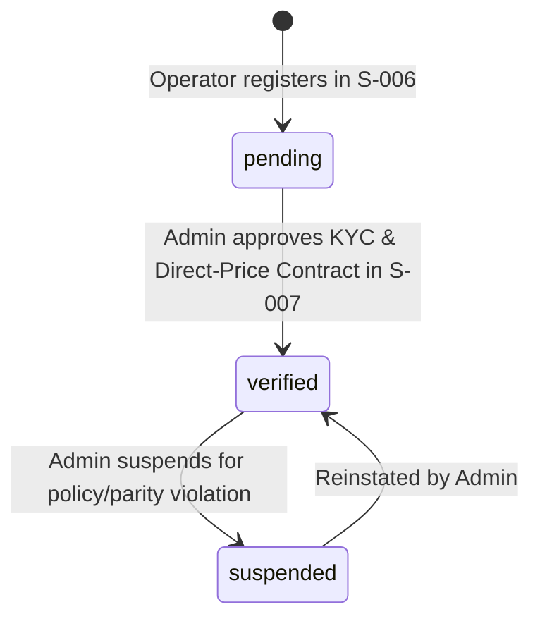

# E-001 Organizer (Tour Operator / Partner)
Product term: Organizer (`Организатор туров` / `Supplier`) · Parent: none · Status: done

## Fields

| Field | Type | Required | Default | Constraints or enum | Source |
|---|---|---|---|---|---|
| `id` | `uuid` | yes | generated | Primary key | [doc SRC-007] |
| `slug` | `string` | yes | derived | Unique URL slug (`/organizers/:slug`) | [doc SRC-001] |
| `brandName` | `string` | yes | — | Public brand name shown on every tour card | [doc SRC-001] |
| `legalName` | `string` | yes | — | Registered KR legal entity (`ОсОО` / `ИП`) | [doc SRC-003] |
| `registrationNumber` | `string` | yes | — | INN / OKPO / License ID | [doc SRC-003] |
| `baseCity` | `string` | yes | `'Bishkek'` | `'Bishkek'`, `'Karakol'`, `'Osh'`, `'Naryn'`, `'Cholpon-Ata'` | [doc SRC-002] |
| `bio` | `string` | yes | — | Public story, fleet description, and specialization | [doc SRC-001] |
| `logoUrl` | `url` | yes | — | Square brand logo | [doc SRC-001] |
| `directSiteUrl` | `url` | no | `null` | Organizer's own website/Instagram used by Admin to audit Direct-Price Parity (`R-002`) | [doc SRC-004] |
| `languages` | `string[]` | yes | `['EN','RU']` | `'EN'`, `'RU'`, `'KG'`, `'DE'`, `'FR'` | [doc SRC-005] |
| `isVerified` | `boolean` | yes | `false` | Set `true` only by Admin after KYC & contract check (`R-013`) | [doc SRC-003] |
| `verificationStatus` | `enum` | yes | `'pending'` | `'pending'`, `'verified'`, `'suspended'` | [doc SRC-003] |
| `commissionPercent` | `number` | yes | `15` | Platform agency commission (`10`–`25`), deducted from direct price | [doc SRC-003] |
| `ratingAvg` | `number` | yes | `0` | `0.00`–`5.00`, aggregated across all verified reviews of this organizer (`R-008`) | [doc SRC-001] |
| `reviewsCount` | `integer` | yes | `0` | Total verified reviews across all tours | [doc SRC-001] |
| `toursSoldCount` | `integer` | yes | `0` | Total confirmed/completed bookings (`R-009`) | [doc SRC-006] |
| `peopleSignedUpCount` | `integer` | yes | `0` | Total confirmed/completed participants (`SUM(paxCount)`, `R-009`) | [doc SRC-006] |

## Relations

| Relation | Target | Cardinality | On delete | Source |
|---|---|---|---|---|
| `tours` | E-002 (`Tour`) | `1:N` | Restrict | [doc SRC-001] |
| `bookings` | E-004 (`Booking`) | `1:N` | Restrict | [doc SRC-006] |
| `reviews` | E-005 (`Review`) | `1:N` | Restrict | [doc SRC-005] |

## Lifecycle

## System fields

| Field | Set when | Source |
|---|---|---|
| `createdAt` | Account registration | [doc SRC-006] |
| `verifiedAt` | Admin clicks "Approve & Verify" in `S-007` | [doc SRC-003] |

## Rules
- R-001, R-002, R-008, R-009, R-012, R-013

## Not tested
- None.

