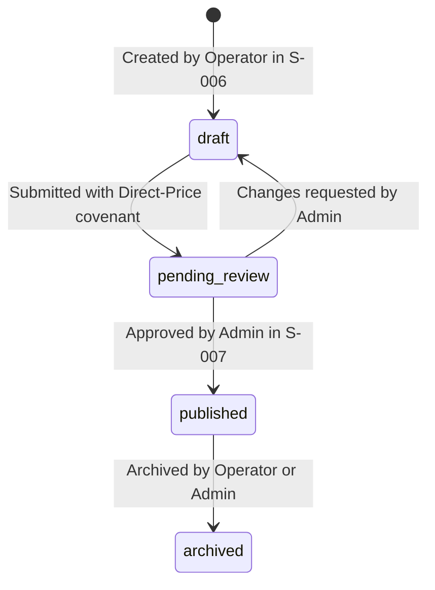

# E-002 Tour
Product term: Tour (`Тур` / `Product Experience`) · Parent: E-001 · Status: done

## Fields

| Field | Type | Required | Default | Constraints or enum | Source |
|---|---|---|---|---|---|
| `id` | `uuid` | yes | generated | Primary key | [doc SRC-007] |
| `organizerId` | `uuid` | yes | — | Foreign key -> `E-001` (`Organizer.id`) | [doc SRC-001] |
| `slug` | `string` | yes | derived | Unique URL slug (`/tours/:slug`) | [doc SRC-001] |
| `title` | `string` | yes | — | Full tour title | [doc SRC-001] |
| `regions` | `string[]` | yes | — | `'issyk-kul'`, `'song-kul'`, `'kel-suu'`, `'karakol'`, `'ala-archa'`, `'sary-chelek'`, `'pamir-osh'` | [doc SRC-002] |
| `activityTypes` | `string[]` | yes | — | `'jeep-4wd'`, `'horseback'`, `'trekking'`, `'cultural-yurt'`, `'day-trip'`, `'winter-ski'` | [doc SRC-002] |
| `durationDays` | `integer` | yes | `1` | `1`–`21` days | [doc SRC-001] |
| `difficultyLevel` | `integer` | yes | `2` | `1` (Easy), `2` (Moderate), `3` (Active), `4` (Challenging), `5` (Expedition) | [doc SRC-001] |
| `comfortLevel` | `enum` | yes | `'standard'` | `'basic_tent'`, `'nomadic_yurt'`, `'standard_guesthouse'`, `'comfort_hotel'` | [doc SRC-001] |
| `maxGroupSize` | `integer` | yes | `12` | `1`–`30` travelers | [doc SRC-001] |
| `minParticipants` | `integer` | yes | `4` | Threshold for automatic Guaranteed Departure (`R-004`) | [doc SRC-001] |
| `basePriceUsd` | `number` | yes | — | Organizer's official direct retail price (0% markup, `R-002`) | [doc SRC-004] |
| `depositPercent` | `number` | yes | `20` | Online deposit percentage (`15`–`30%`, `R-003`) | [doc SRC-002] |
| `freeCancellationDays` | `integer` | yes | `15` | Days before departure for 100% deposit refund (`R-010`) | [doc SRC-004] |
| `itineraryDays` | `jsonb` | yes | `[]` | Array of `{dayNumber, title, description, distanceKm, maxAltitudeM, meals, accommodation}` | [doc SRC-002] |
| `inclusions` | `string[]` | yes | `[]` | Included items (transport, yurts, permits, guide) | [doc SRC-002] |
| `exclusions` | `string[]` | yes | `[]` | Excluded items (flights, personal insurance) | [doc SRC-002] |
| `status` | `enum` | yes | `'draft'` | `'draft'`, `'pending_review'`, `'published'`, `'archived'` | [doc SRC-006] |
| `ratingAvg` | `number` | yes | `0` | `0.00`–`5.00` from verified bookings (`R-008`) | [doc SRC-005] |
| `reviewsCount` | `integer` | yes | `0` | Count of verified reviews for this tour | [doc SRC-005] |

## Relations

| Relation | Target | Cardinality | On delete | Source |
|---|---|---|---|---|
| `organizer` | E-001 (`Organizer`) | `N:1` | Restrict | [doc SRC-001] |
| `departures` | E-003 (`TourDeparture`) | `1:N` | Cascade | [doc SRC-001] |
| `reviews` | E-005 (`Review`) | `1:N` | Restrict | [doc SRC-005] |

## Lifecycle

## System fields

| Field | Set when | Source |
|---|---|---|
| `createdAt` | Initial creation | [doc SRC-006] |
| `priceVerifiedAt` | Admin verifies direct-price parity in `S-007` | [doc SRC-004] |

## Rules
- R-001, R-002, R-003, R-008, R-013

## Not tested
- None.

