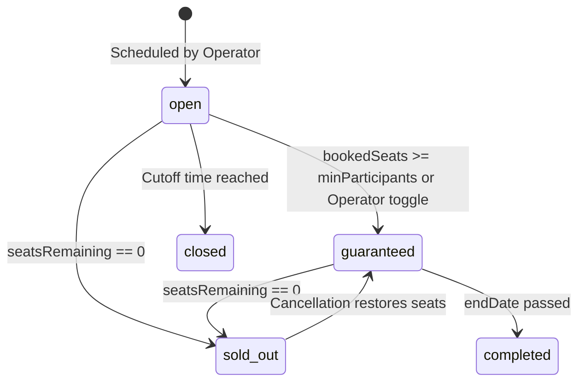

# E-003 TourDeparture (Group Schedule & Seat Quota)
Product term: Departure Slot (`Дата заезда` / `Availability Slot`) · Parent: E-002 · Status: done

## Fields

| Field | Type | Required | Default | Constraints or enum | Source |
|---|---|---|---|---|---|
| `id` | `uuid` | yes | generated | Primary key | [doc SRC-007] |
| `tourId` | `uuid` | yes | — | Foreign key -> `E-002` (`Tour.id`) | [doc SRC-001] |
| `startDate` | `iso-date` | yes | — | Group departure start date (`YYYY-MM-DD`) | [doc SRC-001] |
| `endDate` | `iso-date` | yes | — | Group departure end date (`YYYY-MM-DD`) | [doc SRC-001] |
| `priceUsd` | `number` | yes | `Tour.basePriceUsd` | Direct price per person for this departure (`R-002`) | [doc SRC-001] |
| `maxSeats` | `integer` | yes | `Tour.maxGroupSize` | Total group capacity (`maxSeats >= bookedSeats`, `R-011`) | [doc SRC-001] |
| `bookedSeats` | `integer` | yes | `0` | Confirmed participant count (`SUM(Booking.paxCount)`) | [doc SRC-006] |
| `heldSeats` | `integer` | yes | `0` | Seats locked in 15-min checkout sessions (`R-005`) | [doc SRC-007] |
| `seatsRemaining` | `integer` | yes | computed | `maxSeats - bookedSeats - heldSeats` (`>= 0`) | [doc SRC-001] |
| `isGuaranteed` | `boolean` | yes | `false` | `true` when `bookedSeats >= minParticipants` or manually set by Operator (`R-004`) | [doc SRC-001] |
| `guideLanguages` | `string[]` | yes | `['EN','RU']` | Guide languages for this specific departure | [doc SRC-005] |
| `cutoffHours` | `integer` | yes | `24` | Hours before `startDate` when online booking closes (`R-006`) | [doc SRC-006] |
| `status` | `enum` | yes | `'open'` | `'open'`, `'guaranteed'`, `'sold_out'`, `'closed'`, `'completed'`, `'cancelled'` | [doc SRC-001] |

## Relations

| Relation | Target | Cardinality | On delete | Source |
|---|---|---|---|---|
| `tour` | E-002 (`Tour`) | `N:1` | Cascade | [doc SRC-001] |
| `bookings` | E-004 (`Booking`) | `1:N` | Restrict | [doc SRC-006] |

## Lifecycle

## System fields

| Field | Set when | Source |
|---|---|---|
| `updatedAt` | Seat count or status changes | [doc SRC-007] |

## Rules
- R-004, R-005, R-006, R-010, R-011

## Not tested
- None.

