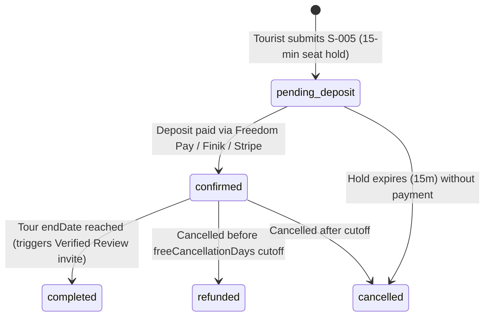

# E-004 Booking (Reservation, Participant Manifest & Deposit Split)
Product term: Booking (`Бронирование / Заявка`) · Parent: E-003 · Status: done

## Fields

| Field | Type | Required | Default | Constraints or enum | Source |
|---|---|---|---|---|---|
| `id` | `uuid` | yes | generated | Primary key / Booking Reference | [doc SRC-007] |
| `departureId` | `uuid` | yes | — | Foreign key -> `E-003` (`TourDeparture.id`) | [doc SRC-007] |
| `tourId` | `uuid` | yes | — | Foreign key -> `E-002` (`Tour.id`) | [doc SRC-007] |
| `organizerId` | `uuid` | yes | — | Foreign key -> `E-001` (`Organizer.id`) | [doc SRC-006] |
| `leadTravelerName` | `string` | yes | — | Full name of primary booker | [doc SRC-006] |
| `leadEmail` | `email` | yes | — | Email for voucher & verified review token | [doc SRC-006] |
| `leadPhone` | `string` | yes | — | WhatsApp / Telegram phone number | [doc SRC-006] |
| `paxCount` | `integer` | yes | `1` | Number of people signed up (`1..seatsRemaining`, `R-005`, `R-009`) | [doc SRC-006] |
| `participants` | `jsonb` | yes | `[]` | Array of `{fullName, age, nationality, passportCountry}` | [doc SRC-006] |
| `dietaryNotes` | `string` | no | `null` | Dietary/medical/gear requests for mountain guides | [doc SRC-006] |
| `totalAmountUsd` | `number` | yes | computed | `paxCount * TourDeparture.priceUsd` (Direct Organizer Price, `R-003`) | [doc SRC-004] |
| `depositAmountUsd` | `number` | yes | computed | Online deposit paid on platform (`totalAmountUsd * depositPercent / 100`, `R-003`) | [doc SRC-004] |
| `balanceDueToOrganizerUsd` | `number` | yes | computed | `totalAmountUsd - depositAmountUsd` paid directly to Organizer (`R-003`) | [doc SRC-004] |
| `platformCommissionUsd` | `number` | yes | computed | `totalAmountUsd * Organizer.commissionPercent / 100` | [doc SRC-006] |
| `paymentGateway` | `enum` | yes | `'freedom_pay'` | `'freedom_pay'`, `'finik'`, `'stripe'`, `'mbank_qr'` | [doc SRC-008] |
| `paymentGatewayRef` | `string` | no | `null` | Transaction reference from acquiring gateway | [doc SRC-008] |
| `status` | `enum` | yes | `'pending_deposit'` | `'pending_deposit'`, `'confirmed'`, `'completed'`, `'cancelled'`, `'refunded'` | [doc SRC-007] |

## Relations

| Relation | Target | Cardinality | On delete | Source |
|---|---|---|---|---|
| `departure` | E-003 (`TourDeparture`) | `N:1` | Restrict | [doc SRC-007] |
| `organizer` | E-001 (`Organizer`) | `N:1` | Restrict | [doc SRC-006] |
| `review` | E-005 (`Review`) | `1:1` | Restrict | [doc SRC-006] |

## Lifecycle

## System fields

| Field | Set when | Source |
|---|---|---|
| `createdAt` | Checkout initiated | [doc SRC-007] |
| `confirmedAt` | Payment webhook succeeded | [doc SRC-007] |
| `completedAt` | Departure `endDate` passed | [doc SRC-006] |

## Rules
- R-003, R-005, R-007, R-009, R-010, R-012

## Not tested
- None.

