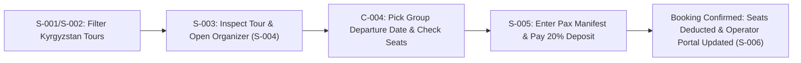

# FL-001 Tourist Direct-Price Discovery & Deposit Booking Flow
User goal: Find a Kyrgyzstan tour, inspect the real organizer and verified reviews, and book seats at the organizer's direct price by paying only the reservation deposit online · Features: F-001, F-003, F-004, F-005, F-006, F-008 · Status: done

## Steps

| # | Screen | User action | System response | Evidence |
|---|---|---|---|---|
| 1 | S-001 / S-002 | Tourist filters Kyrgyzstan tours by region (e.g. `Song-Kul & Karakol`), month (`July`), and comfort level (`Yurt & Guesthouse`) | Displays matching tour cards with **Open Organizer Name/Rating**, **Direct Price Badge**, and next available departure dates | [doc SRC-001] |
| 2 | S-003 / S-004 | Tourist clicks into Tour Detail (`S-003`) and optionally inspects the Organizer's Public Profile (`S-004`) and past verified reviews | Shows day-by-day itinerary, exact comfort/bathroom details, organizer legal verification badge, and verified reviews with photos | [doc SRC-002] |
| 3 | S-003 | Tourist selects a specific departure row in the Departure Matrix (`C-004`, e.g., `Jul 14–20 · 4 spots left · Guaranteed`) | Locks selection into the sticky booking card and calculates **20% Online Deposit** vs. **80% Balance Paid to Organizer on Arrival** | [doc SRC-004] |
| 4 | S-005 | Tourist enters `paxCount = 2`, traveler names, WhatsApp/Email contact, and clicks "Pay Deposit & Reserve 2 Seats" | Places 15-minute atomic seat hold (`R-005`), processes deposit via Freedom Pay / Finik / Stripe (`BR-001`), sets `Booking.status = confirmed`, decrements `seatsRemaining` by 2, and increments the Organizer's **Tours Sold** (`+1`) & **People Signed Up** (`+2`) in `S-006` | [doc SRC-007] |

## Branches and errors

| At step | Condition | What happens | Evidence |
|---|---|---|---|
| 3 | Selected departure is within `cutoffHours` before start | Online checkout is locked (`R-006`); tourist is offered next departure date or instant operator inquiry | [doc SRC-006] |
| 4 | Another tourist books the last seats simultaneously | Atomic DB lock rejects second checkout before payment and prompts user to choose another date (`R-005`) | [doc SRC-007] |
| Post-4 | Tourist cancels `>= freeCancellationDays` (e.g. 15 days) before departure | Full deposit is refunded automatically (`R-010`), `seatsRemaining` increases by `paxCount`, and operator KPI counters adjust | [doc SRC-004] |

## Diagram

## Not tested
- Live payment gateway callback (L4 Observe-Only).

