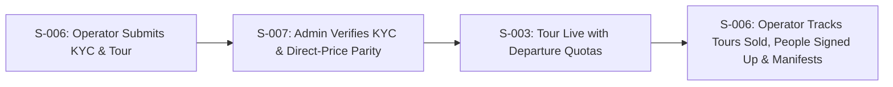

# FL-002 Tour Operator Onboarding, Quota Management & Sales/Signup Tracking
User goal: Onboard as a verified Kyrgyz tour organizer, publish tours at direct price, and track how many tours were sold and how many people signed up · Features: F-006, F-009, F-010, F-011, F-012 · Status: done

## Steps

| # | Screen | User action | System response | Evidence |
|---|---|---|---|---|
| 1 | S-006 | Tour Operator registers and uploads Kyrgyz legal details (ИП/ОсОО, company bio, guides, direct website/Instagram link) | Creates `Organizer` record in `pending_verification` state and notifies Platform Admin (`S-007`) | [doc SRC-003] |
| 2 | S-007 | Platform Admin verifies operator documents, sets agency commission %, and clicks "Approve & Verify" | Sets `Organizer.isVerified = true` (`R-013`) and activates public Organizer Profile (`S-004`) | [doc SRC-003] |
| 3 | S-006 / S-007 | Operator creates a tour with day-by-day itinerary, direct price, and departure dates (`maxSeats = 12`); Admin audits price parity (`R-002`) and publishes | Tour appears on `S-001`, `S-002`, `S-003`, and `S-004` with `"Direct Organizer Price"` badge | [doc SRC-003] |
| 4 | S-006 | As tourists book (`FL-001`), Operator opens `/partner/dashboard` (`S-006`) | Dashboard displays real-time **Total Tours Sold**, **Total People Signed Up (`Pax`)**, departure fill progress bars, participant manifests (names, WhatsApp, dietary notes, balance to collect on Day 1), and 1-click `[-]`/`[+]` seat sync | [doc SRC-006] |

## Branches and errors

| At step | Condition | What happens | Evidence |
|---|---|---|---|
| 3 | Operator submits a price higher than their own website/Instagram | Admin rejects price edit during parity audit (`R-002`) and requires matching their direct price | [doc SRC-004] |
| 4 | Operator sells 2 spots directly via Instagram/WhatsApp | Operator clicks `[-]` twice on that departure in `S-006` to reduce `seatsRemaining` so the platform never overbooks (`B-003`) | [doc SRC-006] |

## Diagram

## Not tested
- Live partner portal session (L4 Observe-Only).

