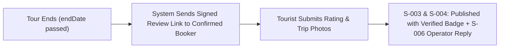

# FL-003 Post-Trip Verified Tourist Review Collection & Organizer Reply
User goal: Collect authentic reviews exclusively from real tourists who completed the tour and surface them on both the Tour and Organizer pages · Features: F-003, F-007, F-011 · Status: done

## Steps

| # | Screen | User action | System response | Evidence |
|---|---|---|---|---|
| 1 | System Cron | `TourDeparture.endDate` passes for a `confirmed` booking | System transitions `Booking.status` to `completed` and sends a unique signed review link (`ReviewInviteToken`) to the tourist via Email/WhatsApp | [doc SRC-006] |
| 2 | S-003 | Tourist opens the signed link, rates Guide, Route, Accommodation, Transport & Overall (`1–5`), uploads trip photos, and submits review | System verifies token belongs to a `completed` booking (`R-007`), attaches the `"✓ Verified Tourist"` badge with the exact tour & trip date, and recalculates both `Tour.ratingAvg` and `Organizer.ratingAvg` (`R-008`) | [doc SRC-006] |
| 3 | S-006 | Tour Operator receives alert in `/partner/dashboard` and posts an official thank-you or clarification reply | `Review.organizerReply` appears publicly below the tourist's review on both `S-003` (Tour page) and `S-004` (Organizer profile) | [doc SRC-006] |

## Branches and errors

| At step | Condition | What happens | Evidence |
|---|---|---|---|
| 2 | Anonymous visitor without a `completed` booking tries to post a review | Rejected (`R-007`): reviews cannot be submitted without a verified completed booking | [doc SRC-006] |
| 2 | Review already submitted for that `Booking.id` | Token is single-use; allows editing within 7 days, prevents duplicate reviews | [doc SRC-006] |

## Diagram

## Not tested
- Post-trip email trigger execution (L4 Observe-Only).

